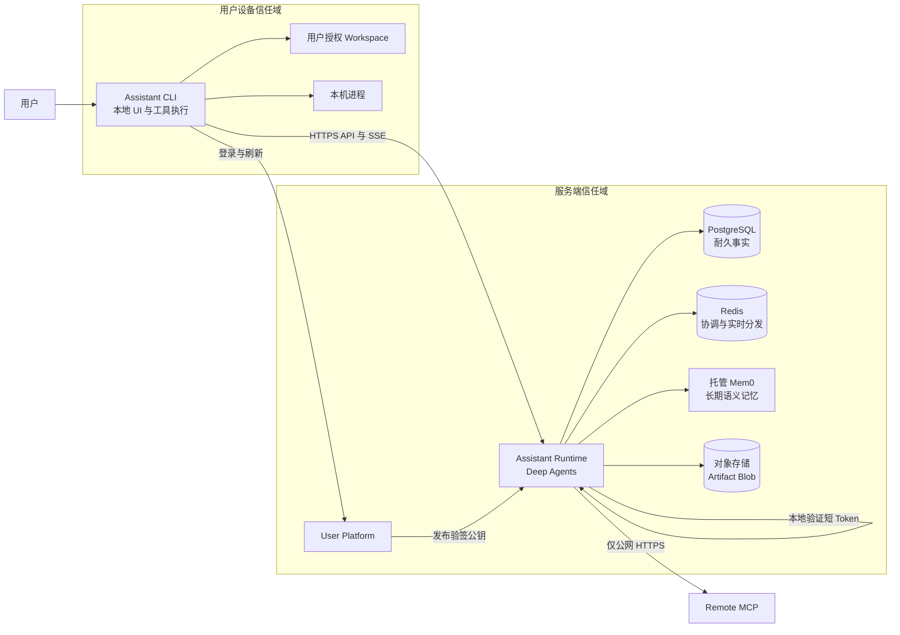
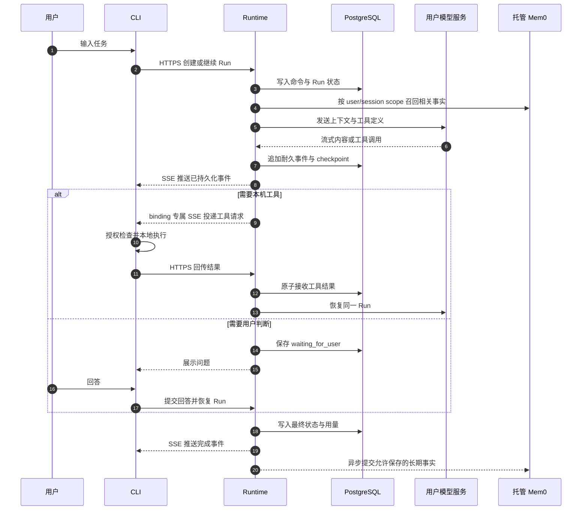
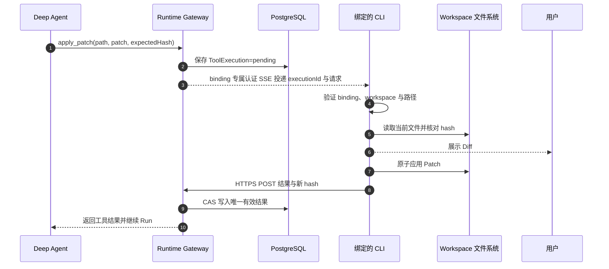
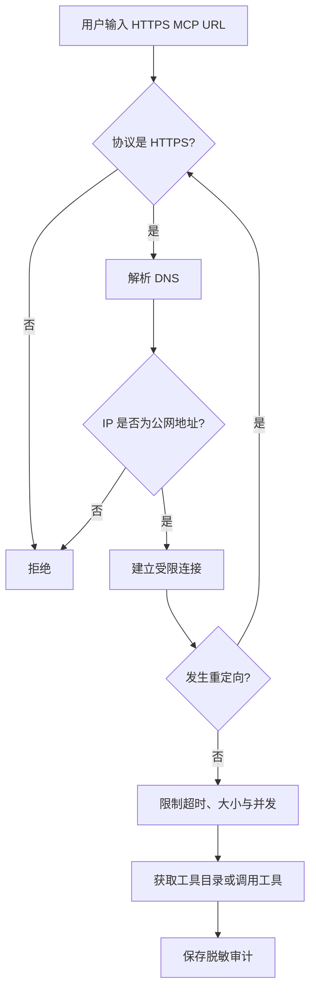
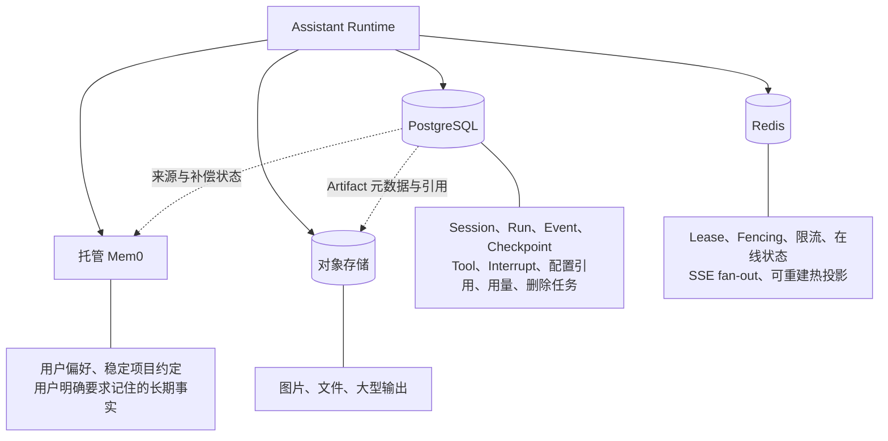
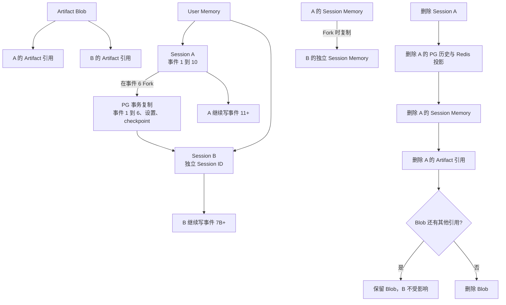
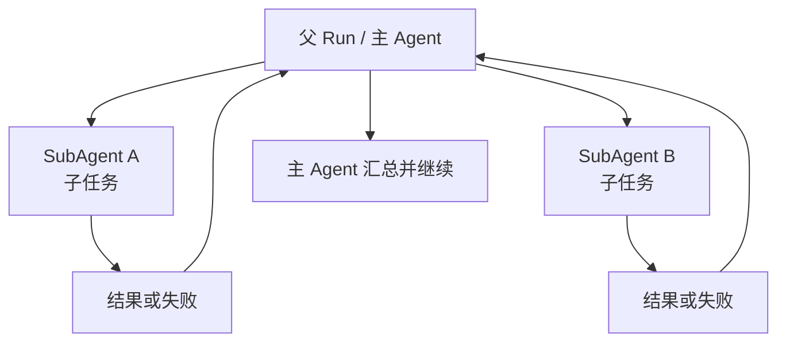
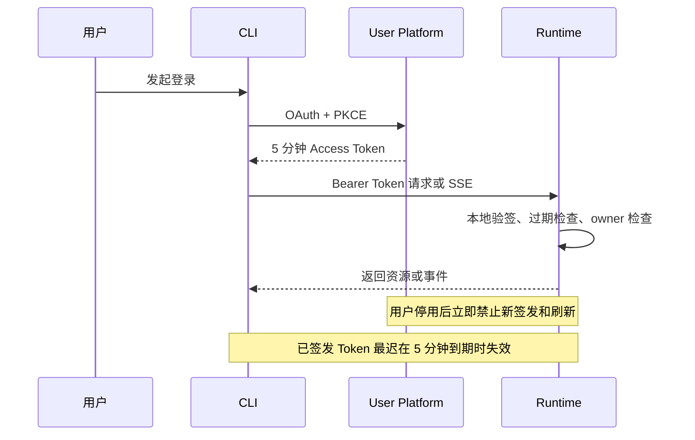

# Node Assistant Runtime 方案知识分享（Proposal）

> 日期：2026-10-05
>
> 状态：**proposal / 设计说明，不代表已经实现或上线**
>
> 读者：参与 Assistant Runtime、CLI、平台服务、数据与安全建设的研发同学
>
> 目标：用一份可讨论的架构说明，解释 Node Assistant Runtime 如何在服务端运行 Agent，同时安全地操作用户本机工作区。

## 功能清单（开头速览）

- 服务端使用 Deep Agents 驱动 Run、SubAgent、暂停与恢复；不集成 Studio。
- CLI 是本地工作区的唯一执行者，负责文件读取、搜索、Patch 和 Shell。
- 本地工具与远程 MCP 是两条不同链路；开发期仓库内 MCP 走 HTTP localhost，用户配置的远程 MCP 只允许公网 HTTPS。
- 用户自行输入 `baseURL`、`apiKey`、`model`，并可选填 `reasoning effort`、`service tier`。
- PostgreSQL 保存耐久事实和加密凭证；Redis 只做可重建的协调与实时分发；托管 Mem0 保存受约束的长期语义记忆。
- Session 支持 Fork、Revert、Revert-and-edit；Fork 后两条 Session 历史相互独立。
- Artifact 只共享底层 Blob；用户级记忆跨 Session 共享，Session 级记忆 Fork 后独立。
- 只实现真正的 SubAgent，不实现 Suggested Sessions。
- Access Token 有效期为 5 分钟；用户停用后禁止签发和刷新，旧 Token 最迟到期失效。
- 本地读/搜默认自动，Patch 展示 Diff 后执行，Shell 默认确认；Session 可开启 workspace 内自动执行，workspace 外始终禁止。

## 1. 为什么这样设计

我们要解决的不是单纯的聊天，而是一个同时具备耐久会话、Agent 编排、本地代码编辑、远程工具、长期记忆和恢复能力的开发助手。

最大的物理边界是：**Deep Agent 在服务器上，用户代码在自己的电脑上。** 服务器无法也不应该直接挂载用户磁盘；CLI 才是用户本机文件与进程的所有者。因此本方案将“决定调用什么工具”和“真正执行本机副作用”拆开：Runtime 负责决策、持久化与调度，CLI 在授权 workspace 内执行。

这也解释了几个关键取舍：

- 不集成 Studio：Studio 适合调试 Graph，但不能替代正式产品中的设备绑定、workspace 授权、断线恢复和本机审批。
- 不使用 stdio MCP：托管 Runtime 若执行用户提供的 stdio 命令，会扩大为服务端远程代码执行入口。
- 不把 Redis 当数据库：断电、淘汰或 Flush 不应令 Session 和等待中的工具调用消失。
- 不让 Mem0 代替聊天历史：语义记忆适合召回稳定事实，不适合承担精确、有序、可审计的运行记录。

## 2. 术语表

| 术语               | 本方案中的含义                                                                        |
| ------------------ | ------------------------------------------------------------------------------------- |
| Runtime            | 服务端 Assistant Runtime，负责 Agent 编排、持久化、权限、流式事件与工具调度。         |
| Deep Agent         | 运行在 Runtime 内的 Agent 主循环；模型通过 LangChain Chat Model 接入。                |
| Run                | 一次可持续、暂停、恢复或取消的 Agent 执行。                                           |
| Session            | 用户可继续、Fork、Revert、归档或删除的对话与运行容器。                                |
| SubAgent           | 当前 Run 派生的真实子任务，结果回到父 Agent；不是一个新的顶级 Session。               |
| Local Tool Gateway | Runtime 与指定 CLI 之间的本机工具投递与结果回传协议。                                 |
| CLI binding        | 某个 Session 与具体 CLI 实例、设备和 workspace 的安全绑定。                           |
| MCP                | 工具协议；开发时仓库内服务走 HTTP localhost，远程服务只连接通过安全检查的公网 HTTPS。 |
| Artifact           | 图片、文件或大型输出等二进制/大对象；元数据在 PG，Blob 在对象存储。                   |
| Mem0               | 托管的长期语义记忆服务，仅保存允许进入长期记忆的提取事实。                            |
| Revert             | 将当前 Session 的活动历史回退到某个事件点。                                           |
| Revert-and-edit    | 回退到某条用户消息，编辑后从该处重新运行。                                            |

## 3. 总体组件与信任边界



Runtime 不直接访问用户磁盘，也不主动连接 NAT 后的电脑。CLI 主动建立到 Runtime 的 HTTPS/SSE 连接，并以 binding 标识自己负责的设备和 workspace。本地工具请求只能投递到该 binding，不能因为同一用户在另一台电脑在线就改投。

## 4. 一次 Run 如何执行



重要语义：SSE 断开不等于 Run 停止。Runtime 先把事件写入 PG，再向客户端推送；CLI 重连后通过 cursor 补齐缺失事件。Redis 可以帮助 fan-out，但不能成为唯一事件来源。

## 5. 用户模型配置

用户在 CLI 输入以下信息：

```text
Base URL: https://api.example.com/v1
API Key:  ********
Model:    user-defined-model
Reasoning effort (optional): high
Service tier (optional):     priority
```

设计规则：

- `model` 是用户输入的自由文本，不依赖固定模型枚举。
- `reasoning effort` 和 `service tier` 是可选模型参数，不是 Deep Agents 自身参数；未填写就不发送。
- Runtime 使用 `baseURL + apiKey + model` 动态创建模型实例，再交给 Deep Agent。
- Runtime 在初始请求、每次 redirect 和每次实际模型连接前重新解析目标；若变成 loopback、private、link-local 或 metadata 地址，在发送 API Key 前拒绝。
- 连接测试必须使用用户填写的模型发起最小请求，不能只探测 URL 是否可达。
- 自定义服务不支持可选参数时，要把明确错误返回用户，不能静默忽略。
- API Key 不进入命令参数、Shell 历史、CLI 配置、日志、SSE 或 Mem0。
- API Key 由 Runtime 加密后存入 PostgreSQL；Session 只保存凭证引用和默认模型，Run 保存最终生效配置的审计快照。
- Redis 不保存明文 API Key。

## 6. 本地编辑与命令执行

Deep Agent 看见的是稳定的工具接口，例如 `read_file`、`search`、`apply_patch`、`exec_command`。这些工具的实现不在服务器触碰磁盘，而是通过 Local Tool Gateway 交给 CLI。



### 6.1 默认审批策略

| 操作                       | 默认行为                       | 可否放宽                                       |
| -------------------------- | ------------------------------ | ---------------------------------------------- |
| workspace 内文件读取、搜索 | 自动执行                       | 无需额外放宽                                   |
| Patch、文件修改            | 展示 Diff 后执行，不逐次弹确认 | 仍需保留 Diff 与变更证据                       |
| Shell                      | 默认请求确认                   | 用户可对当前 Session 开启 workspace 内自动执行 |
| workspace 外访问           | 永远禁止                       | 不能通过确认或自动执行策略绕过                 |

CLI 必须阻止 `../`、符号链接和真实路径解析后的 workspace 逃逸。修改文件前比较 hash，防止覆盖用户刚刚产生的并发修改。每次调用使用唯一 `executionId`，Runtime 只接受一次有效结果。

对于非幂等 Shell，如果 CLI 可能已经执行但结果在网络中丢失，应标记 `result_unknown`，而不是自动重放。CLI 断线时 Run 等待原 binding 重连，不能改投到另一台设备。

## 7. MCP：只允许公网 HTTPS

远程 MCP 和本地工具必须保持分离：

- 仓库内 `mcp-app-collections` 在开发/测试使用 `http://localhost:9021`，无需本地 TLS。
- 生产环境和用户配置的远程 MCP 只接受 `https://` URL。
- 禁止服务端 stdio MCP，也不通过 CLI 转发 stdio MCP。
- 允许用户配置任意公网 HTTPS MCP，而不是只允许管理员白名单。
- Runtime 必须对初始 URL、每次 DNS 解析、所有重定向和最终连接地址执行 SSRF 检查。
- 对用户配置的远程 MCP 拒绝 loopback、私网、link-local、云元数据地址和解析结果发生危险变化的目标；localhost 例外只属于开发/测试的仓库内服务。
- 设置连接、读取和总超时，以及响应体、并发和重定向上限。
- MCP 凭证加密存储；日志、审计和 SSE 只能出现脱敏引用。



仅校验 URL 字符串中的域名不够，因为 DNS 重绑定和重定向都可能把公网域名导向内网地址。

## 8. PostgreSQL、Redis、Mem0 与对象存储如何协作



### 8.1 职责原则

- **PG 管事实**：精确历史、状态机、checkpoint、所有权、幂等与审计必须可从 PG 恢复。
- **Redis 管速度和协调**：Redis 全部清空后，系统仍能从 PG 重建；Redis 不保存唯一业务事实或明文凭证。
- **Mem0 管长期语义记忆**：用于跨回合召回稳定事实，不保存完整聊天、精确执行状态或原始文件。
- **对象存储管 Blob**：PG 保存 Artifact 元数据和引用，不把大文件塞入数据库、Redis 或 Mem0。

### 8.2 Mem0 允许与禁止的数据

允许保存：

- 用户稳定的技术栈和代码风格偏好。
- 项目长期有效的架构约定。
- 用户明确要求记住的内容。
- 多个 Session 会重复使用的提取事实。

禁止保存：

- API Key、Token、密码、Cookie 和任何模型、OAuth、MCP 凭证。
- 完整 Shell 输出、错误堆栈、源代码、Patch、文件原文或聊天全文。
- 临时运行状态、未确认推断和一次性敏感信息。

用户必须能在 CLI 查看、修改和删除自己的长期记忆。Mem0 写入或删除失败时，由 PG 中的补偿状态驱动重试，不能假装已成功。

## 9. Fork、Revert 与删除生命周期

Session 历史采用接近 Kodex 的独立复制语义，不建设共享消息 DAG。



具体规则：

- Fork 在 PG 事务中复制截至目标事件的已提交消息、事件、设置和 checkpoint。
- 新 Session 记录 `forked_from_session_id` 和 `forked_from_event_id`，仅用于展示与审计。
- Fork 后 A、B 的消息和运行历史完全独立；删除 A 不能影响 B。
- Artifact 只复制引用，底层 Blob 不复制；没有任何引用后才物理删除。
- 用户级记忆属于用户，跨 Session 共享，不随单个 Session 删除。
- Session 级记忆在 Fork 时复制到 B，之后 A、B 独立演化。
- Redis 不复制持久数据，而是根据新 Session 的 PG 状态生成热投影。
- 外部清理部分失败时，PG 中的删除任务保持 `pending` 或 `partially_failed` 并重试未完成步骤。

### 9.1 Revert 与 Revert-and-edit

- `Fork`：保留原 Session，从历史事件创建独立新 Session。
- `Revert`：移动当前 Session 的活动历史终点，并取消不再有效的进行中 Run。
- `Revert-and-edit`：回退到目标用户消息，提交编辑后的新消息并创建新 Run。
- 被回退裁掉的历史不能立即物理删除，以便审计和一致性恢复。
- Revert 使用版本号或 CAS，避免与正在提交事件的 Run 相互覆盖。

这三种行为不能互相替代，因此全部保留。

## 10. SubAgent，而不是 Suggested Sessions

本方案只实现真正的 Deep Agents SubAgent：



- SubAgent 属于当前 Run 的子 Run，结果自动回到主 Agent。
- 支持并行执行，并在 CLI 展示父子关系、状态、输出和失败原因。
- 权限、workspace、工具范围、Mem0 scope 和预算只能继承或缩小，不能扩大。
- 父 Run 取消时向仍在执行的 SubAgent 传播取消。
- SubAgent 不自动生成顶级 Session。
- 不实现“Agent 建议一批独立 Session，再等待用户确认创建”的 Suggested Sessions。

这是明确的产品取舍，而不是遗漏。它降低了两套任务拆分模型并存带来的 UI、持久化和验收复杂度。

## 11. 身份、Token 与资源授权

用户登录、资源授权和第三方凭证是三件不同的事：

1. User Platform 完成登录与助手准入。
2. Runtime 本地验证短寿命 Access Token，并对每个 Session、Run、Artifact、MCP、凭证和 binding 校验 owner。
3. 模型 API Key 与 MCP 凭证独立加密保存，不能当作登录凭证。



选择短 Token 到期撤销，是为了避免一期引入每请求 introspection、全局 deny list 和跨实例即时撤销总线。代价是停用后的最长 5 分钟窗口，这一窗口必须作为已知安全边界记录，而不是描述成“立即撤销”。

## 12. 关键风险与边界

| 风险                                 | 必须具备的控制                                                      | 不接受的降级                   |
| ------------------------------------ | ------------------------------------------------------------------- | ------------------------------ |
| 自定义 `baseURL` / MCP URL 导致 SSRF | HTTPS、逐次 DNS/IP/重定向校验、私网拒绝、超时与大小上限             | 只用正则检查 URL               |
| API Key 泄漏                         | PG 加密、密钥引用、日志/SSE/审计脱敏、CLI 隐藏输入                  | 明文 Redis、命令参数、配置文件 |
| 工具误投到错误设备                   | Session + CLI instance + workspace binding、lease/fencing、结果 CAS | 同用户设备之间自动改投         |
| workspace 逃逸                       | 真实路径校验、`..`/符号链接防护、workspace 外始终拒绝               | 用户确认后允许任意磁盘访问     |
| 非幂等命令重复执行                   | execution ID、ACK、结果 CAS、`result_unknown`                       | 网络错误后自动重跑             |
| Redis 丢失                           | 所有耐久状态在 PG，可重建投影                                       | Redis 保存唯一 pending 状态    |
| Mem0 污染或越权                      | scope、来源、敏感信息过滤、查看/纠错/删除、失败补偿                 | 写入聊天全文或凭证             |
| Fork/删除误伤                        | 独立历史、Artifact 引用、用户/Session 记忆分层、可重试删除任务      | 删除源 Session 时级联破坏 Fork |
| SubAgent 权限扩大                    | 只继承或缩小权限、预算和 workspace                                  | 子任务自行获得新凭证或目录     |
| 停用用户仍短暂可访问                 | 5 分钟 TTL，停止签发与刷新，到期关闭连接                            | 宣称即时撤销但没有实现机制     |

## 13. 实施与验收提醒

本文是知识分享用的 proposal，不是实现完成证明。进入生产实现和验收时，至少需要验证：

- 真实 CLI 经 HTTP/SSE 创建 Run、断线重连并补齐事件。
- Local Tool Gateway 在多设备、多 workspace、CLI 断线和重复结果条件下不误投、不重复应用。
- Patch 能检测文件并发修改；Shell 审批策略与 Session 自动执行范围符合约定。
- 自定义模型连接能使用用户输入的 `baseURL`、`apiKey`、`model`，并对可选模型参数明确报错。
- HTTPS MCP 能阻止私网、云元数据、DNS 重绑定和危险重定向。
- Redis 清空或重启后，Run 与等待状态可以从 PG 恢复。
- Mem0 的允许数据、禁止数据、scope、纠错和删除都可观察、可审计。
- Fork、Revert、Revert-and-edit、Artifact 引用和部分失败删除具备端到端证据。
- 父 Run、并行 SubAgent、取消传播和结果汇总行为可重复验证。
- 用户停用、Token 到期和 SSE 关闭符合“最多 5 分钟”的准确语义。

## 功能清单（结尾确认）

- [ ] 服务端 Deep Agent 与耐久 Run；不集成 Studio。
- [ ] 用户自定义 `baseURL`、`apiKey`、`model`，可选 reasoning effort / service tier。
- [ ] PG 加密凭证和保存事实；Redis 可重建；托管 Mem0 仅保存合规长期记忆。
- [ ] CLI 在绑定 workspace 内执行读、搜、Patch、Shell；workspace 外永远禁止。
- [ ] Patch 展示 Diff 后执行，Shell 默认确认，Session 可选择 workspace 内自动执行。
- [ ] MCP 仅允许经过完整 SSRF 防护的公网 HTTPS。
- [ ] Fork 复制独立 Session 历史；Artifact 仅共享 Blob；用户/Session 记忆正确分层。
- [ ] Fork、Revert、Revert-and-edit 全部保留。
- [ ] 真实 SubAgent 支持并行、回传和取消传播；不做 Suggested Sessions。
- [ ] 5 分钟 Access Token 到期撤销，并准确披露最长失效窗口。
- [ ] 所有能力以代码、迁移、真实 CLI E2E 和可复查回执验收，不能用本文替代实现证据。
